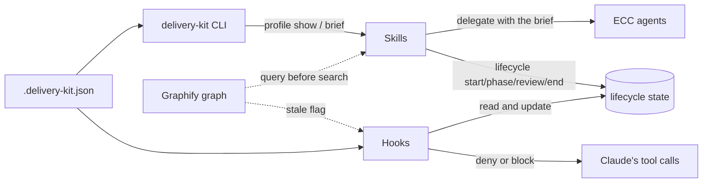
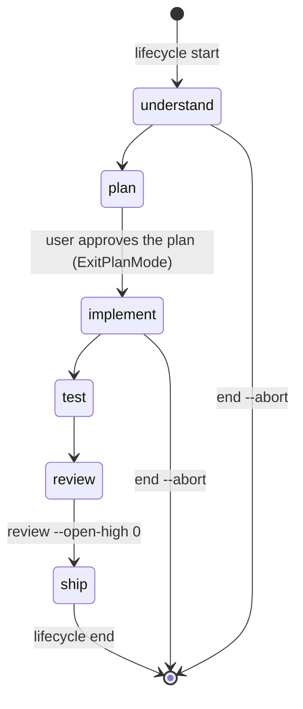

# How it works

The plugin has three parts:

- **Skills** tell Claude how to do a kind of work: the steps, which agents to use, and what the report looks like.
- **Hooks** run outside the model on every relevant tool call and enforce the rules the skills describe.
- **The project profile** (`.delivery-kit.json`) supplies everything specific to a repository, so neither the skills nor the hooks hardcode a project.

## The project profile

Every hook call and CLI command loads the profile fresh:

1. The built-in [defaults](configuration.md#defaults).
2. `.delivery-kit.json` at the project root (shared, committed), merged on top.
3. `.claude/delivery-kit.local.json` (personal, gitignored), merged on top of that.

The project root is `$CLAUDE_PROJECT_DIR` inside Claude Code, otherwise the Git top level, otherwise the current directory.

## Skills

Each skill begins by running `delivery-kit profile show` to learn the project, and `delivery-kit brief [--read-only]` to get the **project brief**. The brief is one paragraph that starts every subagent prompt, because ECC agents start with no knowledge of the repository. It covers:

- what the project is (`project.summary`)
- where its conventions are written (`paths.conventions`) and its house rules (`agents.house_rules`)
- the Graphify rules, when a code graph exists
- read-only rules for review agents
- which secret files never to read
- the only test command agents may run, and a ban on the full suite
- the evidence standard: cite `file:LINE` and mark each claim Confirmed or Suspected

Skills then merge the agents' findings and verify them against the code, so agent output is treated as leads, not as conclusions.

| Skill | Writes code? | Agents |
|---|---|---|
| `feature-lifecycle` | Yes, after the plan is approved | code-explorer, architect, database- and security-reviewer, planner, tdd-guide, code-reviewer, silent-failure-hunter |
| `api-review` | No | stack reviewer, security-reviewer, database-reviewer |
| `architecture-assessment` | No | architect, database-reviewer, security-reviewer |
| `design-proposal` | No | architect, security-reviewer, database-reviewer, then planner |

## The lifecycle

`feature-lifecycle` records its progress through the `delivery-kit lifecycle` commands. The state is a JSON file at `<lifecycle.state_dir>/active.json`, and each lifecycle also gets a folder for its plan.

The phases are labels for the user, set with `lifecycle phase`. The gates depend on three flags, not on the phase. In a full-stack repo, test tracking is per suite: editing `apps/web/app/page.tsx` and `apps/api/src/routes.ts` means both the `web` and `api` suites must pass before shipping, and running only the API's tests doesn't clear the web app.

| Flag | Set by | Cleared by |
|---|---|---|
| `untested_suites` | Editing a file that matches `paths.code` and not `paths.exclude` marks the suite whose `paths` contain it (or `default`) | A passing run of that suite: a Bash command matching the suite's `match` (or `tests.match` for `default`) whose output matches `tests.pass_pattern` and not `tests.fail_pattern` |
| `graph_stale` | The same edit, when a code graph exists | A successful `graph.update_command` |
| `review.open_high` | `lifecycle review --open-high N` | Recording the review again with `0` |

## Hooks

All hooks run `scripts/delivery_kit_main.py hook <name>` and **fail open**: if the profile can't be loaded or the hook crashes, it logs to stderr and allows the action, so a plugin bug never locks you out.

| Event | Hook | Effect |
|---|---|---|
| PreToolUse `Bash` | `pre-bash` | Denies `git commit` and `gh pr create/edit` that break `git.commit` / `git.pr`, always. While a lifecycle you own is active, also denies `git commit`, `git push` and `gh pr create` while `untested`, `graph_stale` or open Critical/High, or before any review is recorded |
| PostToolUse `Edit\|Write\|MultiEdit\|NotebookEdit` | `post-edit` | Sets `untested` (and `graph_stale`) for code edits |
| PostToolUse `Bash` | `post-bash` | Records test outcomes, clears `untested` on a pass, clears `graph_stale` after a graph update, and records ownership after `lifecycle start` or `claim` |
| Stop | `stop` | Blocks stopping once while code is untested or Critical/High findings are open, and tells Claude why. It doesn't block a second time in a row, so Claude can still stop to ask you something |

Commands are parsed with a shell tokenizer rather than a plain regex, so `grep "git push"` or `echo "git commit"` aren't mistaken for real commits, while `git -C api commit`, `-am`, `--trailer`, `-F file` and heredoc bodies are all recognised.

### Session ownership

Only the session that started (or claimed) a lifecycle is gated. Other sessions on the same repository, such as a teammate's or a parallel agent's, keep only the commit and PR format rules. This keeps one session's untested edits from blocking another's unrelated work. After resuming in a new session, run `delivery-kit lifecycle claim` to take the lifecycle over.

### Turning the gate off

`LIFECYCLE_GATE=off` in the environment, or `"lifecycle": {"enabled": false}` in the profile, disables the lifecycle checks. The commit and PR format rules stay on; remove them from the profile to turn them off.

## What the plugin never does

- It never reads secret files, and it tells every agent not to (`guards.secret_files`).
- It doesn't commit, push or open PRs on its own. It only gates them when you ask Claude to.
- It doesn't run your full test suite unless you ask.
- It doesn't send anything anywhere: all state stays in your repository.
